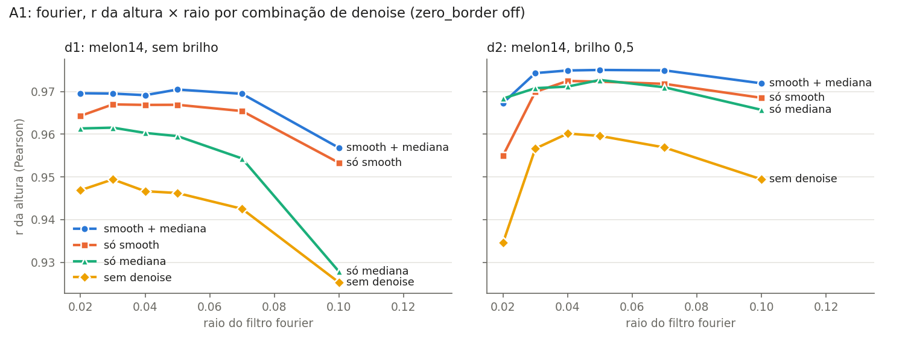
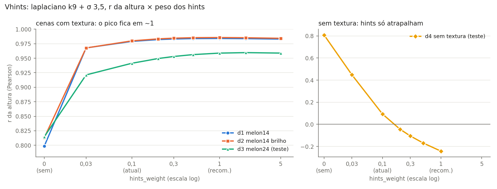

# Relatório: sweep de parâmetros v2 do método híbrido (multi-dataset)

Período: 2026-11-21 a 2026-11-22 · Branch `feat/sweep-v2` · Plano: `docs/superpowers/plans/2026-11-21-sweep-v2.md`
Detalhe por estágio: `docs/relatorios/sweep_v2/` (`<estágio>.md|csv` gerados, `<estágio>-notas.md` analisados).

## Resumo

Foram 464 runs em 4 datasets, nenhum falhou. Configuração recomendada: **laplaciano k9 + smooth σ 3,5 + mediana,
solver fotométrico original e `hints_weight` 1,0**. Em cenas **sem textura**, `use_hints: false`.

| dataset | papel | legacy13 (default anterior) | **recomendada** | Δ |
|---|---|---|---|---|
| d1 stQ-melon14 glo0 | dev | 0,9705 | **0,9840** | +0,014 |
| d2 stQ-melon14 glo0,5 | dev | 0,9751 | **0,9856** | +0,011 |
| d3 stF-melon24 | teste | 0,9440 | **0,9588** | +0,015 |
| d4 stQ-white01 (sem textura) | teste | 0,078 | **0,808** (hints off) | +0,73 |

r = Pearson da altura integrada contra a altura do GT, sem a faixa de escala.

Três achados mudaram a recomendação no caminho:
1. **`smooth_sigma` é o parâmetro mais forte do multifocus.** O r do zMos no d1 sobe de 0,61 para 0,93.
2. **O vencedor do estágio fotométrico era um artefato:** invalidava 15–18 % das normais. Ele foi descartado na
   validação porque d3 era um dataset de teste de outro objeto.
3. Com as normais completas e o zMos de σ 3,5, **o peso ótimo dos hints é 1,0**, não 0,1.

## Contexto: o que mudou desde o sweep de 2026-07

O sweep de 2026-07-10 (`relatorio_sweep_parametros.md`) rodou num só dataset (lamb-gls = melon14 glo0),
com métrica na imagem toda. Desde então:

- **Faixa de escala excluída.** Os PNGs do libmultifok têm 38 linhas de escala cinza no topo, que entravam
  na integração e na avaliação. Durante este sweep apareceu mais um caso: `scale_band_rows` só reconhecia
  o `WxH` no início do nome da pasta. Corrigido, o d1 base passou de r 0,881 para 0,970.
- **`pixel_size` calibrado** por dataset (`scripts/calibrate_dataset.py`): d1 1,80, d2 1,13, d3 1,14, d4 1,81.
- **Pastas de luz com sufixo** (`L000-amb0.00-glo0.00`) e **planos focais só numa luz** (d3: `zf060`) agora
  são tratados. O pipeline usa os planos comuns a todas as luzes.
- **Novos parâmetros do multifocus:** `median_ksize` (3/5) e `smooth_sigma` (gaussiano com σ livre, em vez do
  binomial 3×3 fixo).
- **Infraestrutura:**
  - rerun parcial (`hybrid-rerun`: reaproveita multifocus e/ou fotométrico);
  - métrica restrita ao objeto do GT;
  - framework de sweep em estágios (`configs/sweep_v2/`).

## Desenho

- **Datasets.** Desenvolvimento: d1 e d2 (melon14 sem brilho e com brilho 0,5). Teste: d3 (melon24, outro
  objeto e outro empilhamento) e d4 (white01, sem textura, caso de estresse).
- **Métrica primária:** `integration_height_object.pearson_r`. Desempate pelo `rmse_affine`.
  - **Empate:** |Δr| < 0,005 e ΔRMSE < 2 %. No empate vence a config com menos overrides.
  - **Escolha multi-dataset:** maior média de r, desde que min r ≥ (melhor min r) − 0,01.
- **Estágios.** Cada estágio parte do vencedor do anterior e roda em modo `full`, `photometric` ou `integration`
  conforme o que muda.

| estágio | o que varia | runs |
|---|---|---|
| S0 / S0conv | smoke, determinismo, convergência (`max_iter` × `conv_tol`) | 23 |
| A1 | medida de foco (fourier r / laplaciano k / wavelet) × smooth × mediana × zero_border | 178 |
| A2 | OFAT em torno do top-3 de A1: r_max, interpolação, square, median_ksize, smooth_sigma | 72 |
| B | `shadow_threshold` × `outlier_threshold_multiplier` | 62 |
| C1/C2/C3 | `hints_weight` × `initial_method`; sensibilidade de `pixel_size`; medida de foco × B | 40 |
| V / Vhints / Vfinal | candidatos nos 4 datasets; peso dos hints; reconfirmação com hints 1,0 | 89 |

**Regra de borda.** Se o vencedor cai no limite da grade, a grade é estendida antes de promover. Isso
aconteceu 4 vezes: smooth_sigma, o canto de B, e duas vezes `hints_weight` no Vhints.

**Determinismo.** Dois runs idênticos dão `metrics.json` idêntico. Diferenças pequenas são reais, não ruído.

## Resultados por estágio

### A1: medida de foco × pré-processamento



| fator | d1 (média de r) | d2 (média de r) |
|---|---|---|
| smooth on / off | 0,958 / 0,946 | 0,963 / 0,955 |
| mediana on / off | 0,954 / 0,950 | 0,963 / 0,955 |
| zero_border off / on | 0,955 / 0,949 | 0,967 / 0,951 |
| melhor fourier / melhor laplaciano / wavelet | 0,9705 / 0,9653 / 0,892 | 0,9751 / 0,9752 / 0,953 |

- O base (legacy13) já era o melhor do A1. O platô de fourier entre r 0,02 e 0,07 com denoise é largo.
- smooth e mediana sempre ajudam; zero_border sempre atrapalha.
- Sem denoise, o raio pequeno colapsa com brilho (d2 r0,02: 0,935).

### A2: refino do multifocus

| smooth_sigma | binomial (≈0,7) | 0,75 | 1,5 | 2,5 | **3,5** | 5,0 |
|---|---|---|---|---|---|---|
| d1 (fourier 0,05): r altura / r zMos | 0,9705 / 0,61 | 0,970 / 0,61 | 0,975 / 0,74 | 0,978 / 0,87 | **0,9784 / 0,93** | 0,977 / 0,97 |
| d2 (laplaciano k5): r altura / r zMos | 0,9751 / 0,79 | 0,975 / 0,79 | 0,978 / 0,84 | 0,980 / 0,92 | **0,9810 / 0,96** | 0,981 / 0,98 |

- r_max ≠ 2 sempre piora. A interpolação quadrática e `median_ksize` 3 dão efeito nulo ou negativo.
- `square` ajuda sozinho, mas não soma com σ 3,5: as duas coisas fazem o mesmo papel.

### B: solver fotométrico, e por que o vencedor foi descartado

Em d1/d2, o r da altura melhorou de forma monotônica até `outlier_threshold_multiplier` 1,5 (d1 0,9836, d2 0,9849), e
o erro angular das normais caiu pela metade. Na validação, d3 caiu de 0,944 para 0,80.

O motivo: com om < 2, `wps.py` grava NaN quando sobram menos de 3 luzes após a rejeição.
- **O dano:** 15 % dos pixels em d1/d2 e 18 % em d3 ficam sem normal, e a integração passa a depender só dos hints.
- **Por que parecia ganho:** em melon14 os hints são bons, então o fallback parecia melhora. O erro angular "melhor" também é seleção, porque a métrica só conta pixels válidos.

Os relatórios ganharam a coluna `photometric_normals.valid_fraction`. Com as normais 100 % válidas
(om ≥ 2), mudar o solver não acrescenta nada à recomendada. No Vfinal, a variante sh 0,05 + om 2 (duas mudanças
juntas) empata em d1/d2 e perde em d3.

### C: integração

- `initial_method` (zero/hints) não tem efeito: as métricas saem idênticas em todos os pesos. A hipótese é que a
  integração multiescala só usa o chute no nível mais grosso. Não foi verificado no código C.
- `pixel_size` ±25 % mexe menos de 0,0002 no r. Não há sinal de erro de calibração.
- O C1 apontou `hints_weight` 0,1 como pico, mas sobre o solver de B, com os pixels NaN. O resultado foi revisto no Vhints.

### V: validação nos 4 datasets

Os candidatos rodaram com hints 0,1; os com sufixo "+ B" usam o solver om 1,5.

| config | d1 | d2 | d3 | d4 | normais válidas d3 |
|---|---|---|---|---|---|
| legacy13 | 0,9705 | 0,9751 | **0,9440** | 0,078 | 100 % |
| legacy13 + B | 0,9668 | 0,9786 | 0,8028 | −0,50 | 82 % |
| fourier σ 3,5 + B (vencedor d1) | 0,9836 | 0,9844 | 0,8800 | −0,11 | 83 % |
| lap k5 σ 3,5 + B (vencedor d2) | **0,9854** | 0,9849 | 0,9246 | −0,28 | 83 % |
| lap k9 σ 3,5 + B | 0,9841 | **0,9851** | 0,9209 | −0,25 | 83 % |
| fourier σ 3,5 | 0,9784 | 0,9793 | 0,9211 | **0,44** | 100 % |
| lap k9 σ 3,5 | 0,9790 | 0,9799 | 0,9413 | 0,09 | 100 % |
| lap k9 σ 3,5 + sh 0,05 / om 2 | 0,9815 | 0,9821 | 0,9364 | 0,00 | 100 % |

O r da imagem toda coincide com o r no objeto em todos os runs, porque a máscara do GT cobre 100 % da imagem
(ver Limitações). Por isso a tabela traz uma coluna só. A escolha multi-dataset sobre d1–d3 deu **lap k9 σ 3,5** (`sweep_v2/V-agregado-d1d3.md`; a tabela completa com o d4 está em `sweep_v2/V.md|csv`).
Em d4 todas as configs com hints são ruído, então ele é decidido pelo peso dos hints.

### Vhints: peso dos hints



| hints_weight | 0 | 0,03 | 0,1 | 0,3 | **1,0** | 2,0 | 5,0 |
|---|---|---|---|---|---|---|---|
| d1 | 0,799 | 0,968 | 0,979 | 0,983 | **0,9840** | 0,984 | 0,983 |
| d2 | 0,813 | 0,968 | 0,980 | 0,985 | **0,9856** | 0,985 | 0,984 |
| d3 | 0,815 | 0,921 | 0,941 | 0,953 | **0,9588** | 0,9596 | 0,959 |
| d4 | **0,808** | 0,448 | 0,093 | −0,105 | −0,242 | — | — |

Entre 1 e 2 há um platô: no d3, 2,0 dá 0,9596 contra 0,9588 de 1,0, o que é empate pela regra. Foi escolhido 1,0, o menor
peso do platô. O ganho do híbrido sobre o multifocus sozinho (`hybrid_gain`) tem o pico no mesmo ponto: a altura
não vira cópia do zMos. O Vfinal reconfirmou a escolha de medida de foco com hints 1,0: lap k9 σ 3,5 fica em
primeiro em d1 e d3 e empata no d2 (0,98564 contra 0,98572 da variante sh 0,05 / om 2), com a maior média (0,9761). Fourier σ 3,5 vem em seguida (0,9733), e legacy13 com hints 1,0 fica com 0,9630.

## Configuração recomendada

Aplicada em `configs/hb_experiment.yaml`:

```yaml
multifocus.focus_measure.method: laplacian
multifocus.focus_measure.parameters.kernel_size: 9
multifocus.focus_measure.preprocessing: {smooth: true, smooth_sigma: 3.5, spatial_median_filter: true,
                                         median_ksize: 5, square: false, zero_border: false}
multifocus.optimization.r_max: 2
photometric.solver: {shadow_threshold: 1.0e-3, outlier_threshold_multiplier: 3}   # inalterado; manter om >= 2
hybrid.integration: {use_hints: true, hints_weight: 1.0, initial_method: zero, max_iter: 5000}
# cena sem textura: use_hints: false
```

## Comparação com o sweep de 2026-07

| config | o que é | d1 2026-07 (imagem toda, com faixa) | d1 v2 | d2 v2 | d3 v2 |
|---|---|---|---|---|---|
| legacy13 | fourier 0,05 + denoise, sem zero_border | 0,859 | 0,9705 | 0,9751 | 0,9440 |
| legacy15 | laplaciano + denoise | 0,842 | 0,9605 | 0,9699 | — |
| **recomendada** | lap k9 + σ 3,5 + hints 1,0 | — | **0,9840** | **0,9856** | **0,9588** |

A maior parte do salto 0,86 → 0,97 vem da exclusão da faixa de escala. O ganho de parâmetros do v2 sobre a
melhor config de 2026-07 é de +0,011 a +0,015 nos datasets com textura, mais a regra "hints off sem textura".
O padrão "laplaciano tem multifocus melhor, mas fourier integra melhor" de 2026-07 se inverte com σ 3,5:
o laplaciano k9 suavizado passa a vencer nas duas medidas.

## O que foi aprendido

1. **Validar em outro objeto é indispensável.** d1 e d2 são o mesmo objeto. Sem d3, o sweep teria recomendado
   om 1,5, que perde 0,06 numa cena nova.
2. **Desconfie de métricas que só olham os pixels válidos.** O erro angular "melhorou" porque o solver descartava os pixels difíceis.
   Toda métrica condicional agora sai junto com a fração de pixels válidos.
3. **Os parâmetros interagem entre estágios.** O peso ótimo dos hints mudou de 0,1 para 1,0 quando o solver
   voltou ao original e o zMos melhorou. Estágios sequenciais precisam de reconfirmação no fim (Vfinal).
4. **Suavizar o indicador de foco vale mais que escolher o indicador.** A diferença entre medidas some com σ 3,5.
5. **A cena sem textura pede outro regime.** Lá o multifocus não tem informação, e qualquer peso de hints destrói a
   altura. As normais sozinhas dão 0,81.

## Limitações

- **A máscara "objeto" do GT cobre 100 % da imagem nos 4 datasets.** O "fundo 8 %" do relatório
  `2026-11-21-fundo-vs-normais.md` era a faixa de escala. Lá, o ganho do oráculo (0,88 → 0,97 no d1) corresponde a
  tirar a faixa, o que agora já é feito. Não há fundo real nestes datasets, portanto a detecção de fundo
  (adiada pelo usuário) não pode ser medida aqui.
- **Poucos objetos.** São só dois objetos texturizados (melon14 e melon24) e um sem textura. O ótimo de σ e de
  hints pode depender da frequência da textura e do passo focal.
- **Sem auto-seleção de hints.** A regra "sem textura → hints off" exige que o usuário saiba o tipo de cena. A
  confiança média do multifocus (0,03 em d4) pode servir de gatilho automático, mas isso não foi implementado.
- **`initial_method` sem efeito.** A explicação multiescala é hipótese; não foi conferida no C.
- **d4 é sensível à convergência.** O S0 com max_iter 10000 deu 0,040, e o V com 5000 deu 0,078. Em
  problemas mal condicionados, os 1e-4 do S0conv (medidos em d1/d2) não valem.

## Reprodução

```bash
python configs/sweep_v2/run.py --stage <S0|A1|A2|B|C1|C2|C3|V|Vhints|Vfinal> --datasets d1,d2[,d3,d4] -j 6 --threads 2 --prune
python configs/sweep_v2/summarize.py --stage <estágio> --datasets ... [--aggregate] [--promote [--top 3] [--pick NOME]]
python docs/relatorios/sweep_v2/make_charts.py
```

Saídas podadas em `data/results/sweep_v2/` (30 GB).
